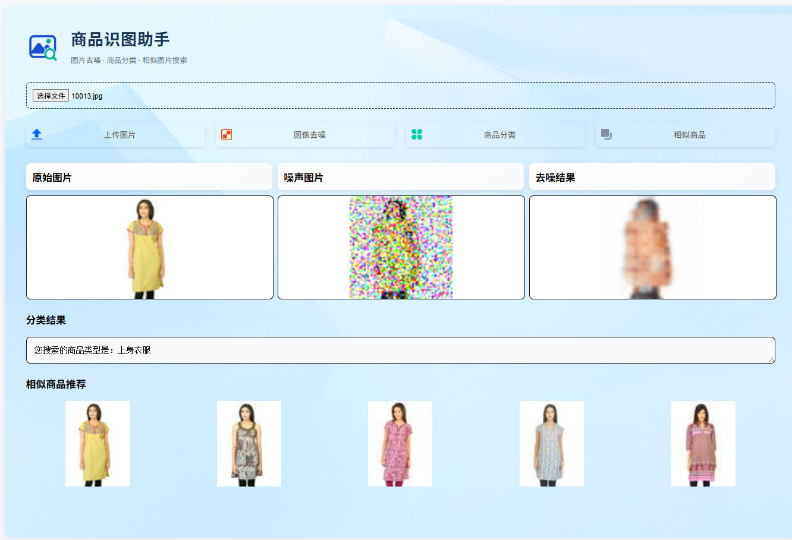
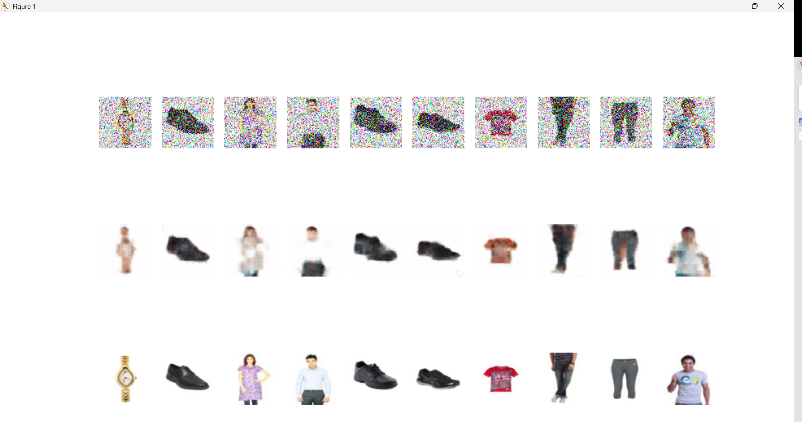
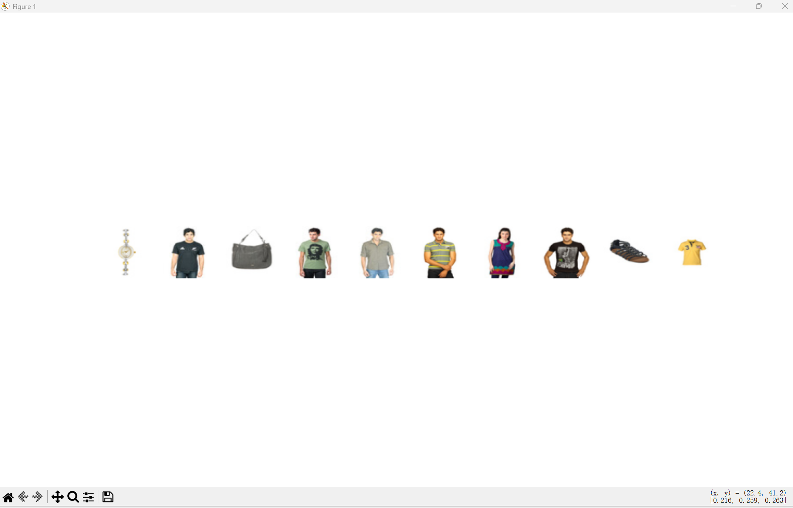
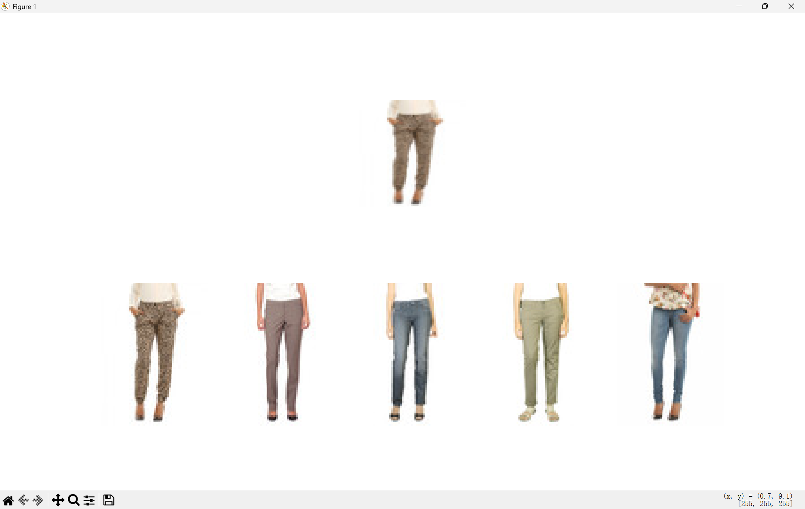

# 商品识别助手 · 智图寻宝

基于 **PyTorch + Flask + Chroma** 的商品图片学习项目，包含图像去噪、五类商品分类、相似图片检索，以及可交互的 Web 演示页面。本仓库对应 `image_similarity_main_jht` 版本，保留课程实践代码和实验截图。



## 功能与流程

| 模块 | 实现 | 输入 → 输出 |
| --- | --- | --- |
| 图像去噪 | 卷积自编码器 ConvDenoiser | RGB 图片 → 加噪图片与重建图片 |
| 商品分类 | CNN 分类器 Classifier | RGB 图片 → 5 类商品之一 |
| 相似检索 | 卷积编码器 + Chroma 持久化向量库 | RGB 图片 → 最相似的 5 张商品图片 |
| Web 页面 | Flask + HTML/CSS/JavaScript | 上传、去噪、分类、展示检索结果 |

所有模型输入均为 **RGB、64 × 64**，经 `ToTensor()` 转为 `[0, 1]` 张量。

网页操作顺序：**选择文件 → 上传图片 → 图像去噪 → 商品分类 / 相似商品**。

- “上传图片”在浏览器中显示预览，点击功能按钮时才向后端发送图片。
- “图像去噪”先给原图添加噪声系数为 `0.5` 的高斯噪声，裁剪到 `[0, 1]`，再送入去噪模型。这是模拟加噪演示。
- **分类和相似检索都提交去噪后的图片**，前端在未去噪时会提示“请先去噪”。
- 建库使用数据集原图；查询时编码器提取查询图片的特征，再在 Chroma 中查找近邻。

五类标签：`0 上身衣服`、`1 鞋`、`2 包`、`3 下身衣服`、`4 手表`。

## 项目结构

```text
image-similarity-search/
├── common/
│   ├── dataset/                        # 自行准备的图片，不上传 Git
│   ├── fashion-labels.csv              # id,target 标签
│   └── utils.py                        # 随机种子、文件名自然排序
├── image_denoising/
│   ├── denoising_config.py              # 数据路径与超参数
│   ├── denoising_data.py                # 加噪、数据集划分
│   ├── denoising_model.py               # ConvDenoiser
│   ├── denoising_engine.py              # 训练、验证、测试循环
│   ├── denoising_train.py
│   └── denoising_test.py
├── image_classification/
│   ├── classification_config.py
│   ├── classification_data.py
│   ├── classification_model.py          # Classifier
│   ├── classification_engine.py
│   ├── calssification_train.py          # 原文件名如此，注意拼写
│   └── classification_test.py
├── image_similarity/
│   ├── similarity_config.py
│   ├── similarity_data.py
│   ├── similarity_model.py              # ConvEncoder、ConvDecoder
│   ├── similarity_engine.py
│   ├── similarity_train.py
│   ├── similarity_embedding.py          # Chroma 建库与查询，embedding 为单数
│   └── similarity_test.py
├── web/
│   ├── web_app.py                       # Flask 入口
│   ├── templates/index.html             # 页面、样式与交互脚本
│   ├── pictures/                        # 图标与背景
│   └── logo/
├── test/                                # 学习 Notebook，不是 unittest 套件
├── artifacts/branding/                  # 品牌设计资料
├── study.ipynb
├── img.png / img_1.png / img_2.png / img_3.png
├── requirements.txt
└── README.md
```

本版本没有 `scripts.check_dataset`、`predict.py`、`common.inference` 或 `tests.test_project`，也没有 `--device`、`--epochs`、`--rebuild` 等 CLI 参数。训练参数需修改各模块的 `*_config.py`。

## 环境准备

可使用独立 Python 3.12 环境。依赖包括 PyTorch、torchvision、NumPy、pandas、Pillow、Flask、Chroma、matplotlib、tqdm、SymPy。`requirements.txt` 是依赖清单，未锁定版本，安装后需验证实际兼容性。

```powershell
git clone https://github.com/hongtingjiang717-del/image-similarity-search.git
Set-Location image-similarity-search
conda create -n image_similarity_jht python=3.12 pip -y
conda activate image_similarity_jht
python -m pip install -r requirements.txt
```

已有环境可直接激活。本次读取到本机既有环境的主要版本为 `torch 2.15.0+cpu`、`torchvision 0.29.2+cpu`、`chromadb 1.5.9`。这是本地环境记录，不代表已在全新环境复现。GPU 环境需自行安装兼容的 torch/torchvision。

**运行目录很重要**：代码混用包导入与同级模块导入，通过 `../common/dataset/` 等相对路径定位文件。先在项目根目录设置 `PYTHONPATH`，再进入相应模块目录运行脚本：

```powershell
# 每次打开新终端后，在项目根目录重新设置
$env:PYTHONPATH = (Get-Location).Path
```

以下命令均以项目根目录为起点，`Push-Location` / `Pop-Location` 用于进入模块目录并返回。

## 数据、权重与上传范围

GitHub 版本包含源码、CSV 标签、实验截图、页面资源和学习 Notebook。**不包含商品数据集、模型权重、Chroma 数据库、IDE 配置及旧源码备份**，这些文件在原本机目录中保留。克隆后需自行准备数据并训练，或放入可信且结构匹配的权重。

本机数据集有 **24,853 张图片**，文件名为 `0.jpg` 至 `24852.jpg`；CSV 使用 `id,target` 两列，例如：

```csv
id,target
0,3
1,3
2,3
3,0
```

图片放在 `common/dataset/`。当前分类代码按自然排序后的**位置索引**取标签，检索库也用位置索引作为 ID，前端按 `<ID>.jpg` 加载图片。请保持连续编号、图片顺序和标签对应关系，勿直接替换为任意文件名的数据集。

| 用途 | 路径 |
| --- | --- |
| 去噪 | image_denoising/denoiser.pt |
| 分类 | image_classification/classifier.pt |
| 检索编码器 | image_similarity/deep_encoder.pt |
| 重建解码器（训练/重建使用） | image_similarity/deep_decoder.pt |
| 向量库 | image_similarity/chroma_backend/，集合名 image_similarity |

本机还有带 `_30` 后缀的历史权重，当前配置默认加载无此后缀的文件。仅保留模型文件不会自动生成检索索引，仍需单独建库。

## 训练、测试与建库

当前默认配置：

| 模块 | 轮数 | 训练/验证/测试比例 | 损失 | 优化器 |
| --- | --- | --- | --- | --- |
| 去噪 | 30 | 75% / 15% / 10% | MSE | Adam |
| 分类 | 30 | 75% / 15% / 10% | CrossEntropy | AdamW |
| 相似检索自编码器 | 15 | 70% / 15% / 15% | MSE 重建损失 | Adam |

默认批次大小为 `32`、学习率为 `0.001`。训练入口设置种子 `42`，设备优先选择可用 CUDA，否则使用 CPU。模型在验证损失下降时保存；**再次训练会覆盖同名权重，请先备份**。训练脚本在导入时也会执行训练，勿把它们当作工具模块导入。

### 1. 图像去噪

```powershell
Push-Location image_denoising
python denoising_train.py
python denoising_test.py
Pop-Location
```

网络通过三次卷积与池化压缩图像，再通过转置卷积恢复分辨率，末层 Sigmoid 输出 RGB 图像。训练目标是由带噪图片重建原图。

### 2. 商品分类

```powershell
Push-Location image_classification
python calssification_train.py
python classification_test.py
Pop-Location
```

分类器由两组卷积、ReLU、最大池化与全连接层组成，输出 `[N, 5]` logits，预测时取最大值所在类别。注意训练入口保留了原来的 `calssification_train.py` 拼写。

### 3. 相似检索模型与向量库

```powershell
Push-Location image_similarity
python similarity_train.py
python similarity_embedding.py
python similarity_test.py
Pop-Location
```

编码器将 `[N, 3, 64, 64]` 压缩为 `[N, 512]`，解码器再重建为图片。**编码器和解码器分成两个类，是因为训练时需要两者共同计算重建损失，建库和检索时只需要编码器**，这样可直接获取特征而无需执行解码。

建库脚本先将所有图片读入内存，再以每批 `5000` 条调用 `upsert` 写入 Chroma；分批写入不等于分批读取，内存不足时需改造。当前代码没有显式 L2 归一化或指定余弦距离，不能把输出描述为“余弦相似度”。

更换编码器或图片集合后需要重新建库。`upsert` 不会删除已不存在的旧 ID；更换数据集时，应停止相关程序并备份后清理旧库再构建。本版本没有自动重建参数。

## 启动 Web 演示

准备好去噪、分类、检索编码器权重，并完成建库后：

```powershell
# 在项目根目录设置 PYTHONPATH 后执行
Push-Location web
python web_app.py
Pop-Location
```

访问 [http://127.0.0.1:9000](http://127.0.0.1:9000)。启动时立即加载权重，缺少权重时首页也无法启动；空向量库无法提供有效检索结果。

按顺序上传图片、去噪，再进行分类或检索。更换图片后请再次去噪，以更新后续功能所用图片。

| 方法 | 路径 | 请求 / 返回 |
| --- | --- | --- |
| GET | / | 返回演示页面 |
| POST | /denoising | multipart/form-data 字段 image；返回 noisy_img、denoised_image，均为 PNG Base64 |
| POST | /classification | 字段 image；返回中文分类文本 |
| POST | /simimages | 字段 image；返回 indices_list，包含 5 个近邻 ID |
| GET | /dataset/&lt;filename&gt; | 提供数据集商品图片 |
| GET | /pictures/&lt;filename&gt;、/logo/&lt;filename&gt; | 提供页面资源 |

后端直接处理收到的图片；网页选择提交去噪图。直接调用分类/检索接口时也可上传原图。本版本没有 `/health` 接口。

## 已有实验记录

以下数值来自原 README / 代码注释的历史记录，**本次整理没有重新训练或复测**，不能当作当前环境的复现结果或其他数据集上的性能保证。

### 图像去噪

| 记录 | 训练损失 | 验证损失 |
| --- | --- | --- |
| 第 1 / 30 轮 | 0.038139 | 0.019433 |
| 第 30 / 30 轮 | 0.008137 | 0.008150 |

历史训练耗时约 1 小时 21 分钟。原文测试误差约 `0.04518`；但测试脚本传入的是 `L1Loss()`，实际计算 **L1 / MAE**，尽管输出文字写成“均方误差”。不能与训练的 MSE 直接比较。仅凭训练和验证损失下降，也不能完全排除过拟合。



### 商品分类

历史实验运行了 10 轮，当前配置则为 30 轮。第 7 轮验证损失最低，为 `0.041565`；之后训练损失继续下降、验证损失上升，提示可能出现过拟合。按训练逻辑选择最佳验证损失对应的权重。

原记录测试准确率为 `0.9947686116700202`，约 **99.48%**。该结果只对应当时的数据、划分和权重；当前实现未持久化数据划分清单，不能据此宣称跨数据集准确率。



### 相似检索

历史建库记录写入了 24,853 张图片特征。下图展示查询图与返回商品；项目尚未提供 Recall@K 等量化检索评估。重建损失下降不直接等于检索质量提高。



## 当前限制与排查

- `ModuleNotFoundError: common`：先在项目根目录设置 `$env:PYTHONPATH = (Get-Location).Path`，再进入模块目录运行；找不到同级配置模块也需检查运行目录。
- 找不到数据或权重：检查工作目录和上述文件位置。本版本没有环境变量路径覆盖功能。
- 自定义数据标签错位、推荐图片不对应：需同步调整分类标签读取、建库 ID 和图片 URL 映射，当前实现依赖连续编号。
- CUDA 分类测试：测试引擎把预测移到 CPU，但标签留在所选设备，可能出现设备不一致；可在 CPU 环境测试，或修正比较前的设备一致性。
- 相似模型验证/测试循环目前调用 `train()`；现有网络无 Dropout / BatchNorm，扩展网络时应改为 `eval()`。Web 推理也未显式调用 `eval()`。
- 去噪验证/测试会重新采样噪声，部分 DataLoader 使用 `drop_last=True` 丢弃尾批；解读指标时需考虑这些实现细节。
- 没有自动化集成测试套件；`*_test.py` 为需要数据和权重的可视化/评估脚本，Notebook 也可能保留旧路径。
- Flask 服务用于本地课程演示，尚未实现完整的上传校验、错误处理与生产部署配置。

本仓库基于课程实践整理。商品图片请自行准备并确认使用权限；仓库未附加软件许可证，使用或分发前请确认相关授权。
